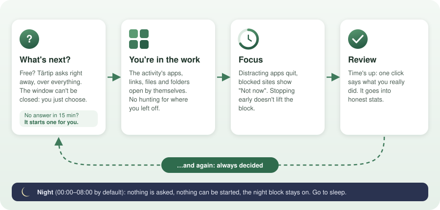

<p align="center">
  
</p>

<h1 align="center">Tärtip</h1>

<p align="center"><b>Use it. Don't get used.</b></p>

<p align="center"><i>Tärtip</i> (тәртип) is Tatar for "order, discipline".</p>

A small macOS menu bar app that starts with a simple focus timer. Choose an activity and a duration, then start. Add blocking, tasks, Pomodoro, reviews, schedules, and stronger discipline tools individually in **Settings → Optional features**. New installations keep these features off; upgrades preserve your existing setup.

<p align="center">
  
</p>

## Optional discipline tools

The following behaviors apply when you enable their corresponding features:

- **It starts for you.** Most focus apps wait until you find the willpower to sit down and choose, and that's exactly where people get stuck: starting takes effort. Tärtip doesn't wait. The moment you're free it asks what's next, the window stays until you answer, and if you don't answer in 15 minutes it picks the activity that's furthest behind and starts it.
- **You land straight in the work.** Starting an activity opens its apps, links, files and folders. No hunting, no "where was I", no thinking about what to open: you're in context within seconds.
- **Distractions are gone, not just discouraged.** Blocked apps quit as soon as they start, and blocked sites turn into a "Not now" page. Stopping the timer early doesn't lift the block.
- **Breaks stay breaks.** Rest has its own block, so a break doesn't turn into a movie. Free time for movies or YouTube comes from a daily budget and can't be taken twice in a row.
- **A plan made calmly holds.** Daily limits, weekdays and hours shape the day, and Today shows what you can pick when, next to what really happened. The settings lock makes sure you can only loosen them after a delay or in a set window, not in a weak moment.
- **Honest stats.** After each session one click says what you actually did, and that's what Stats shows.
- **It sends you to bed.** At night nothing can be started and the night block stays on until morning.

## Install

You need macOS 13 or later (Apple silicon or Intel).

**From the DMG:** download `Tartip.dmg` from the [latest release](https://github.com/stilnar92/tartip/releases/latest), open it, drag Tartip into Applications, and open it from there. The app isn't signed by an identified developer, so the first time macOS refuses to open it. Go to System Settings → Privacy & Security, click **Open Anyway** next to Tartip, and confirm.

**From source** (needs the Xcode Command Line Tools; the installer offers them if they're missing):

```sh
git clone https://github.com/stilnar92/tartip.git
cd tartip
./install.sh
```

Look for ◎ in the menu bar. macOS hides icons that do not fit, so ⌘-drag ◎ next to the clock if necessary.

On a new installation, Tartip starts manually and can be quit normally. **Launch at login** and **Relaunch after quitting** are separate optional settings. Existing installations keep their previous startup behavior. Changing startup settings briefly restarts the app and is deferred by refusal while block locks are active.

No permissions are needed for the basic timer. Enable **Notifications** for completion alerts. Workspace window resizing uses Accessibility; Chrome operations use Automation. Relevant permission controls appear only for enabled features.

**Update:** drag the new version from the DMG over the old one, or run `git pull && ./install.sh`. Your settings and history are kept.

**Uninstall:** `./install.sh --uninstall`. This removes the app and its auto-start. Without the source, run this in Terminal:

```sh
launchctl bootout gui/$UID/com.user.tartip; rm ~/Library/LaunchAgents/com.user.tartip.plist; rm -rf /Applications/Tartip.app
```

Your data in `~/modes` is kept either way.

## How a day works

0. **First launch.** Choose a name (initially **Focus**) and a duration (30 minutes), then press **Start focus**. **Later** dismisses the screen. No blocking, mandatory picker, review, schedule, or background relaunch is enabled. The timer saves elapsed time and returns to idle; the record remains explicitly unreviewed. Sessions shorter than a minute are omitted.

The behaviors below describe the optional tools. Enable only those you need in **Settings → Optional features**. Tasks work without session reviews; scheduling works without continuous guidance. Auto-start and free-time budgets belong to continuous guidance and start at zero for new installations.

1. **Start.** Click ◎ in the menu bar: the **Today** list shows every activity with the time left today. Pick a length at the top (default 30 min, or 🍅 Pomodoro) and click an activity to start it. Right-click a row to start it with a specific length.
2. **Blocking.** The activity's block is locked for the session: set it up in Activities → ⌄ → Blocks; renaming the activity keeps it. Its apps are quit as soon as they start, and its sites are replaced with a "Not now" page in Chrome. Stopping the timer early doesn't lift the block before its time. The first time you start an activity, and whenever what it blocks changes, a warning says what will be closed and blocked and until when. Turning night on and configuring a settings lock also explain their effects. **Rest** is an activity too: a short break between tasks with its own block, so a break doesn't turn into a movie.
3. **Workspace.** The app opens the activity's apps, links, files and folders (set them up in Activities → ⌄ → Opens; a folder opens in Finder). For a one-off site, use **Open a site** before pressing Start.
4. **Review.** When time's up (or you stop), a checklist appears with the plan already checked: one click confirms, or tick what you actually did. That goes into the stats. With Optional features → Review full screen, this checklist covers the whole screen until it's answered.
5. **Always decide.** Whenever nothing is running (no session, no free time) and it isn't night, the "What's next?" window opens right away and can't be closed. With Optional features → What's next? → Full screen it covers the whole screen (menu bar included), can't be moved, and other screens go dark. Nothing is blocked until you pick an activity or free time. If it stays unanswered for 15 minutes, an activity starts by itself for 30 minutes: the one furthest behind its daily limit (Rest only if nothing else can start). The window shows which one and a countdown; both numbers are in Optional features → Timer options.
6. **Free time.** 🍿 Free time blocks nothing (movies, YouTube) and comes from a budget of 60 min a day. It's offered in the "What's next?" window and in the panel, and is only ever taken on purpose. One piece is at most the cap in Optional features → Free time, and the cap itself is always offered (a 10-minute cap gives a 10-minute button). It can't be taken twice in a row; a session has to run in between.
   **Away.** Leaving the computer (lunch, an errand) isn't an activity and needs none: press **Step away** (in "What's next?", the panel, or during a session). The screen locks so the computer can't be used, but the Mac stays awake, so scripts and tasks you left running carry on. Nothing counts while you're away: a running session pauses and its block moves by the same time. Locking the screen yourself or putting the Mac to sleep does the same. It has no length: unlocking ends it, and a paused session goes on. Away for more than an hour ends the session as of when you left. Time away shows as "Away" in Today's Actual column and doesn't touch limits or stats.
7. **Daily limits.** Each activity can have a daily limit (e.g. Work 1h). Once it's used up, the activity drops out of the picker. **New round:** when nothing else can start (a gap before other activities open, or everything done before night), limits start over and "What's next?" keeps asking, so free hours don't go to waste. Activities that open later still get their whole limit.
   **Days.** An activity can be planned for certain weekdays only (e.g. Arabic on Mon, Wed, Fri; set in Activities → ⌄ → Days). On other days it isn't offered, can't be auto-started, and doesn't count toward "What's next?". With no days set it's every day; a day with nothing planned is a day off. A planned day can also have its own limit (Activities → ⌄ → "Different limit on some days", e.g. Work 4h but Sat 1h). "Today" at the top of Activities shows the day as two calendar columns: **Available**, the day cut into periods wherever an activity's hours start or end, each shaded and listing the activities you can pick then (ones without hours are listed once on top as "Any time"; red where nothing can start; it's not a schedule, within a period you choose freely), and **Actual**, the sessions you really ran. The panel shows today as a strip. The plan is only edited in Activities, never from "What's next?", so it can't become a way out.
   **Hours.** An activity can also have hours (e.g. Work 12:00–20:00). Outside them it's greyed out in the picker with "from 12:00".
8. **Night.** From 00:00 to 08:00 the night block is locked until morning (set what it blocks in Optional features → Night). No prompts, no timers, and nothing can be started.
9. **Settings lock** (Optional features → Changing settings; off by default). So a plan made calmly can't be undone in a weak moment: **Lock after a change** keeps settings locked for 2 h … 1 week, starting 10 minutes after your first change; **Only at set hours** allows loosening only in a daily window (e.g. 21:00–21:30). While locked, anything stricter still works (more days, more apps or sites, less free time); anything looser is undone with a note saying why (removing an activity or a blocked site, fewer days, shorter hours, more free time, turning night or auto-start off, weakening the lock itself).

**Daily tasks.** Open **Tasks** in the main window to plan a checklist for each activity for the current day. Press Return to add another task, or paste multiple lines. Edit, reorder and delete tasks there. Before starting a session, expand **Today's tasks** under an activity to preview its checklist. The timer screen stays free of task controls. After a session, select the activities you actually worked on: each selected activity reveals its tasks to mark as completed, plus an optional field for other work. You can report several activities or choose **Other**. Saving the review marks the selected tasks complete and records a snapshot in session history. A session crossing midnight reviews the tasks from the day it began. Tasks survive activity renames and restarts; each day has its own list without automatic carryover.

**Shortcuts** (from any app, listed in Optional features): **⌃⌥⌘L** steps away when Step away is enabled, **⌃⌥⌘T** opens Today.

The numbers above describe the legacy discipline setup. New installations have automatic starts, free-time budgets, and night disabled. **Stats** (today, 7 or 30 days: time per activity, how many sessions ran their full time, auto-starts, time to decide, free time, time away and what got blocked most), **Activities** (list, daily limits, hours, what each opens) and **Optional features** (night, free time, session length) live in one window with a sidebar, opened from the panel's toolbar.

## Blocks

Each activity has its own block, and the night has one too. They live in `~/modes/blocks.json`, by name. The night's is `Focus_Mode`. Edit them in **Activities → ⌄ → Blocks** (and **Optional features → Night**), or in the file:

```json
{ "Work": { "apps": ["com.tdesktop.telegram"], "web": ["google.com"], "exceptions": ["mail.google.com", "github.com"] } }
```

- `apps`: bundle ids, quit while the block is on.
- `web`: sites to block, with subdomains and every path. `*` is a wildcard; `"*"` alone blocks everything.
- `exceptions`: always allowed, even under `"*"` (`youtube.com/watch*`, `file://*.*`).

While a block is locked it can only get stricter: you can add apps and sites and remove exceptions, but not the other way round. The block's editor says so while it's locked, and until when.

Enable **Distraction blocking**, then configure each activity’s block in Activities → Edit. First-run setup does not populate blocks. Disabling a feature retains its configuration; active block deadlines and the review policy of an already-running session remain in force.

## Your data

Settings and history live in `~/modes`, outside the app. Daily task checklists are stored in the app’s UserDefaults under `dailyActivityTasks`:

| File | What |
|---|---|
| `settings.json` | all settings, including activities, daily limits, the block each locks and what each opens (apps, links, files and folders, stretch windows) |
| `blocks.json` | what each block blocks (apps, sites, exceptions) |
| `blocked.html` | the "Not now" page blocked tabs are sent to (written by the app) |
| `logs/sessions.jsonl` | one line per session: start, end, planned, actual; since 1.5 also the real start, planned length, time away, how it ended, whether it started by itself and how long you took to decide |
| `logs/away.jsonl` | one line per stretch away from the computer: start, end |
| `logs/events.jsonl` | free time pieces, blocked apps and sites (the host only, once per session), new rounds |
| `logs/SCHEMA.md` | what every field means, for analysis in DuckDB, pandas, Numbers or an AI (written by the app) |
| `logs/modes.log` | event log: launches, blocks, quit apps, blocked sites, prompts, reviews |

## Known limits

- Sites are blocked in **Google Chrome** only. Chrome's tabs are checked every 1.5 s, so a blocked page can show for a moment. Other browsers (Safari, Firefox, Arc, Edge, Brave, …) are quit while a block with sites is on.
- Blocked apps are asked to quit, then force-quit after 3 s if they're still running.
- A lock can be extended but never shortened.
- This is self-control, not security: anyone with admin rights can unload the launch agent or change the settings.

Working on the code? See [DEVELOPMENT.md](DEVELOPMENT.md).
